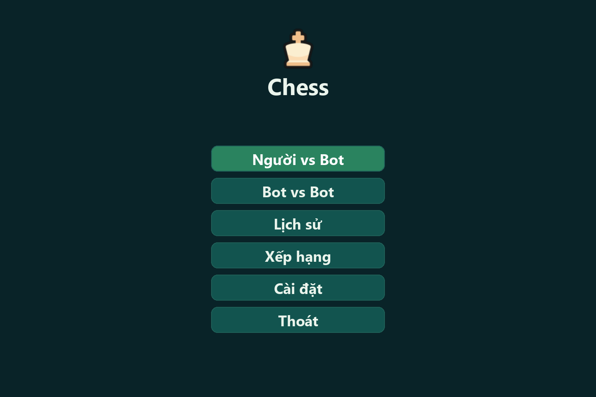
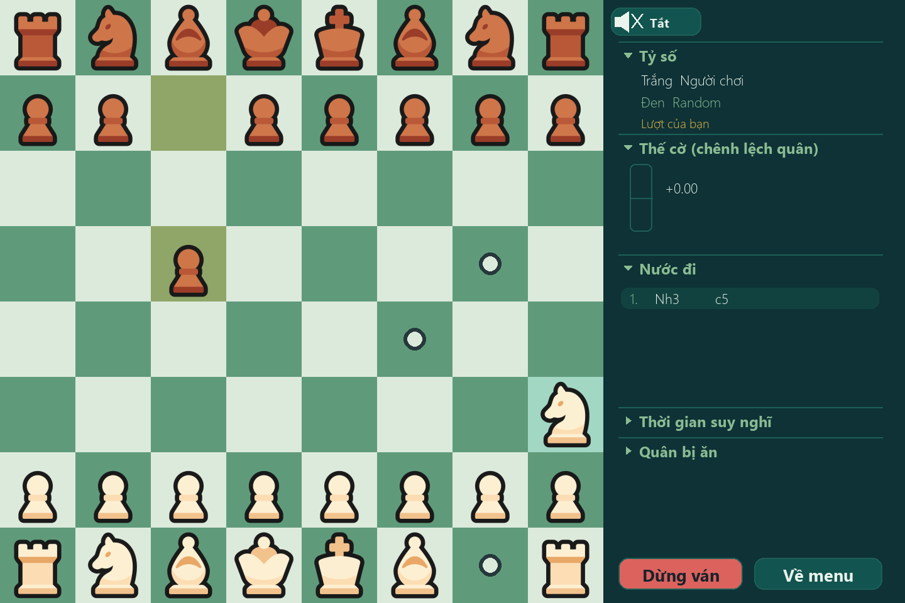

# Chess AI Tournament

Game cờ vua trên Windows: bạn đánh với máy, xem các AI đấu nhau, hoặc mở giải đấu vòng tròn để xếp hạng.
Có 4 AI do nhóm tự làm:
- Alpha-Beta + Hồi quy tuyến tính
- Alpha-Beta + Thuật toán di truyền
- MCTS
- Deep RL ("RL Hybrid")

Ngoài ra có các bot benchmark B1–B9 để so sức.

## Tính năng chính

- **Người vs Bot**, **Bot vs Bot**, **Người vs Người** trên cùng máy.
- **Xếp hạng AI**: giải vòng tròn giữa các bot, có Elo, thời gian và bộ nhớ.
- **Lịch sử**: xem lại các ván đã chơi.
- Thanh đánh giá thế cờ, nhiều giao diện bàn cờ, tiếng Việt / tiếng Anh.

## Yêu cầu

- Windows 10 hoặc 11, bản 64-bit.
- Lần đầu chạy cần Internet và khoảng 2 GB ổ trống, chủ yếu cho PyTorch.
- Không cần cài Python trước: nếu máy chưa có, `run.bat` tự tải bản portable chỉ dùng cho thư mục này.
- Không cần quyền Administrator.

## Cài đặt và chạy (3 bước)

1. Vào https://github.com/august0362/BTL_AI → nút **Code** → **Download ZIP**.
2. Giải nén vào một thư mục bất kỳ, ví dụ `D:\BTL_AI`.
3. Double-click **`run.bat`**.

Một cửa sổ đen hiện tiến trình `[1/4]` → `[4/4]`, rồi game mở ra.

### Lần chạy đầu tiên

Mất khoảng 3–10 phút, tùy tốc độ mạng. `run.bat` tự làm lần lượt:
1. Tìm Python 3.13 trên máy. Nếu không có, tải Python portable (~48 MB) từ nguồn chính thức
   (python-build-standalone) và kiểm SHA-256 trước khi giải nén vào `.runtime\`.
2. Tạo môi trường riêng `.venv\` và cài thư viện (python-chess, pygame, numpy, PyTorch).
3. Tải model AI từ GitHub Release, kiểm kích thước và SHA-256 rồi mới đặt vào `backend\ai\...\weights\`.
4. Mở game.

### Những lần sau

Mở trong vài giây:
- Thư viện không cài lại, trừ khi danh sách thư viện thay đổi.
- `run.bat` hỏi GitHub xem có bản model mới không. Chỉ những file đã đổi mới được tải lại.
- File mới được tải vào file tạm và kiểm SHA-256 trước khi thay file cũ. Tải lỗi thì giữ nguyên model đang dùng.
- Không có mạng thì game vẫn chạy bằng model đã kiểm tra trên máy.

## Thoát game

Đóng cửa sổ game (nút X): mọi tiến trình của game dừng theo và cửa sổ đen tự đóng. Bot chạy ở tiến trình
riêng, gồm giải đấu và Stockfish của Benchmark 9. Nếu đóng cửa sổ đen trước, game cũng tắt theo.

## Gặp lỗi?

| Hiện tượng | Cách xử lý |
|---|---|
| "Khong tai duoc Python" / "Cai thu vien that bai" | Kiểm tra Internet (tắt VPN hoặc proxy chặn GitHub, PyPI) rồi chạy lại `run.bat`. |
| "Chua co model AI va khong tai duoc" | Lần đầu bắt buộc có mạng để tải model. Kết nối mạng rồi chạy lại. |
| Windows SmartScreen chặn `run.bat` | Bấm **More info** → **Run anyway**. |
| Antivirus xóa hoặc chặn file | Cho phép thư mục dự án rồi chạy lại. |
| Lỗi lạ sau khi chép thư mục sang chỗ khác | Xóa thư mục `.venv` rồi chạy lại `run.bat`; nó sẽ tạo lại. |
| Muốn cài lại thư viện | Chạy `run.bat --reinstall` từ Command Prompt. |

## Liên kết

- Mã nguồn: https://github.com/august0362/BTL_AI
- Model: https://github.com/august0362/BTL_AI/releases (tag `models-*`, mỗi bản có `models.json` ghi tên,
  kích thước và SHA-256 từng file).
- Hướng dẫn chơi: [documents/USER_GUIDE.md](documents/USER_GUIDE.md)
- Lịch sử bot Deep RL: [backend/ai/deep_rl/DEEP_RL_EVOLUTION.md](backend/ai/deep_rl/DEEP_RL_EVOLUTION.md)

## Dành cho nhà phát triển

- Cấu trúc thư mục:
  - `backend/`: AI, luật ván, giải đấu, cấu hình
  - `frontend/`: GUI Pygame
  - `another/`: test, script, `launcher.py`
  - `documents/`: tài liệu
  - `environments/`: requirements
- Kiến trúc và hợp đồng bot: [CONTEXT](documents/CONTEXT.md). Quy trình Git/PR:
  [CONTRIBUTING](documents/CONTRIBUTING.md).
- Kiểm tra trước khi gửi PR: `run.bat --test` (pytest), hoặc `another\scripts\test.bat` (pytest + ruff + lint-imports).
- Dữ liệu benchmark thô, log và zip thử nghiệm trong `backend/ai/*/results/` chỉ giữ trên máy,
  không đi kèm bản clone mới. Dữ liệu và tài liệu thử nghiệm đã công bố trước đây vẫn có
  trong lịch sử Git.
- Cấu hình được gộp theo thứ tự:
  1. `backend/config/default.toml`
  2. `backend/config/models.json`: manifest model do `run.bat` ghi, không commit.
  3. `backend/config/local.toml`: tùy chỉnh trên máy mình, không commit.
- Phát hành model mới:
  1. Tạo release tag `models-vN`, đính kèm file `.pt` và `models.json`. Cách viết `models.json`: xem bản
     `models-v1`, với `format` = 1.
  2. `run.bat` của mọi người sẽ tự nhận bản mới ở lần chạy sau.
  3. Đổi cấu trúc manifest thì tăng `format` cùng với `MODEL_FORMAT` trong `another/launcher.py`.
- Credits: [frontend/gui/assets/CREDITS.md](frontend/gui/assets/CREDITS.md).
