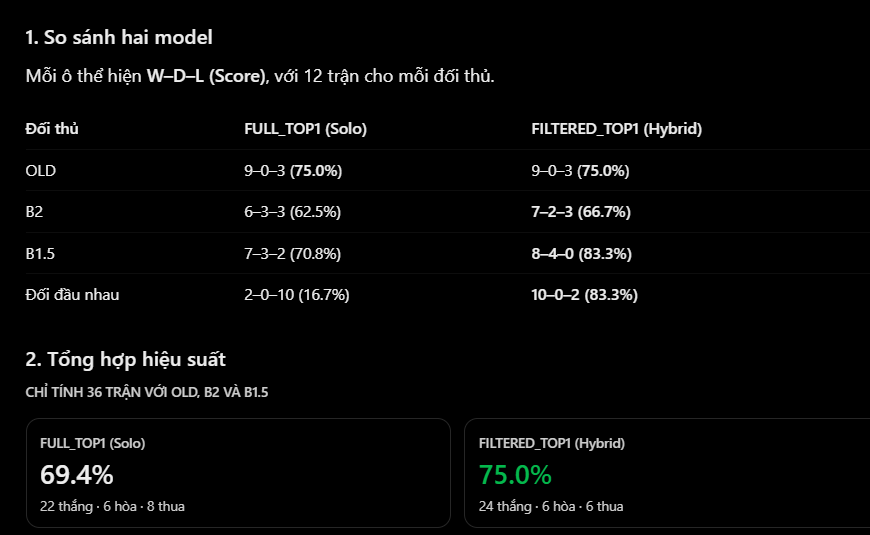

# Deep RL — Quá trình tiến hóa (v1 → V22X)

Bot cờ vua Option 4 của BTL_AI. File này tóm lược toàn bộ lịch sử: mỗi bản đổi gì, vì sao, kết quả ra
sao. Số liệu lấy từ log và ZIP kết quả Kaggle, cập nhật tới 11/11/2026. Notebook và ZIP của các đợt
trước V22 đã xóa ngày 08/11, số liệu của chúng chỉ còn trong file này. `kaggle/` (gitignore) giữ gói V22,
V22 v3, V22X và ZIP kết quả trong `kaggle/output/`. Bot trong ứng dụng là **RL Hybrid** (§12), trọng số
phát hành trên GitHub Release.

Quy ước:
- ply = nửa nước; kết quả ghi Thắng/Hòa/Thua theo bên được kiểm tra; ván chạm trần (cap) không tính hòa.
- B1.5 = `bench_alphabeta_material` (alpha-beta độ sâu 3, chỉ đếm quân); B2 = `bench_alphabeta3`
  (alpha-beta độ sâu 3, quân + PST).

## 1. Tóm tắt

- **Tám giai đoạn:** DQN (v1–v10) → Policy–Value + MCTS kiểu AlphaZero (V11–V13) → mạng lớn + loss phụ
  (V14–V18) → teacher MCTS 96, Value một chiều (V19) → ba mạng chuyên gia theo pha START/MID/END (V20,
  rồi fine-tune END tới u13000) → MID có head chiến thuật (V21) → một mạng START–MID học có giám sát
  từ Stockfish 19 (V22) → dữ liệu Lichess eval DB, 50.000 cập nhật, hai biến thể FULL / FILTERED
  (V22X).
- **Bài học lớn nhất:** tới V21, chưa mạng nào đánh giá thế cờ tốt hơn heuristic đếm quân + PST vì
  Value học từ self-play không khái quát (MSE trên PGN luôn tệ hơn đoán 0). Đổi nguồn nhãn sang
  Stockfish 19 (V22) mới lần đầu thắng được B1.5 và B2 từ khai cuộc chuẩn.
- **Cải tiến có bằng chứng:** CE anchor (v10), bài tập chiếu hết (v8, v10, V13), curriculum V11.2
  (thắng 11–2, p ≈ 0,022), teacher Tablebase + Mate cho END (hòa tự chơi 55 % → 13 %), START A thắng
  START B 6–0, fine-tune END u6000 → u8000 (26,5/40 trước u6000), V21 thắng MID cũ 4/0/2 và giải đúng
  bài chiến thuật 20 % → 40 %.
- **Sức cờ từ khai cuộc chuẩn:** chưa thắng B2; trước B1.5 tốt nhất là hòa (V17.2: 0/3/3, V20 START A:
  0/2/4). Từ FEN trung cuộc, V21 TOP1 gặp B1.5 2/1/3, B2 1/1/4. Ở tàn cuộc, END u13000 hơn B1.5
  (26/40) và nhỉnh hơn B2 (23,5/40).
- **Từ V22:** V22 u18000 + END u13000 (hybrid) thắng B1.5 9/2/1, B2 10/0/2, V21 12/0/0. V22X
  FILTERED u38000 thắng V22 u18000 9/0/3, B2 7/2/3, B1.5 8/4/0 và thắng FULL TOP1 10/0/2.
- **Hiện tại:** bot `deep_rl` trong ứng dụng = RL Hybrid = V22X FILTERED u38000 (START + MID) + END
  u13000, MCTS 200 lượt, tối đa 1 s mỗi nước.

## 2. Niên đại

| Bản | Ngày | Thay đổi chính | Kết quả chính |
|---|---|---|---|
| v1 | 09/10 | DQN tự chơi từ đầu, Q = tanh, Huber, target network | Chỉ mạng: random 24/76/0, greedy 7/91/2 |
| v2 / v2.1 | 10/10 | Pretrain CE từ PGN Kasparov + Carlsen; alpha-beta độ sâu 3, lá = max Q | Top-1 35 %; gặp AB3 0/3/7 |
| v3–v6 | 10/10 | Self-play từ SL, DQfD margin, Backplay, n-step, softmax chuẩn hóa | Q sụp về 0, bỏ |
| v7 | 10/10 | Pretrain có value, PBRS, khinh hòa −0,1, Double DQN | Khử lệch Q +0,42; random 28/22/0 |
| v8 | 11/10 | Bài tập chiếu hết Lichess M1–M4; tắt margin | Puzzle mới M1–4: 72/48/30/16 %; ăn quân 69 → 47 % |
| v9 | 11/10 | Trộn pha cũ để chống quên | Vẫn quên, bỏ |
| v10 | 12–13/10 | Lộ trình đan xen, puzzle chiến thuật, CE anchor β = 0,3 | M1–4: 76/65/59/48 %, ăn quân 65 %; vào cây vẫn thua v1 |
| X đấu Y | 12/10 | Cùng cây tìm kiếm, chỉ đổi hàm đánh giá | Heuristic thắng mọi mạng (v8: 0/4/16) |
| v11 Pure Q | 17/10 | DQN khởi tạo ngẫu nhiên, Q tuyến tính | Mate-in-1 7,7 %; bỏ DQN |
| V11 / V11.1 | 17–18/10 | Policy–Value + PUCT MCTS, Value 2 chiều (hòa −0,1) | Value MSE PGN 0,91–1,10 > đoán 0 (0,684) |
| V11.2 | 18/10 | B_FIXED vs B_CURRICULUM, 7.000 cập nhật | CURRICULUM thắng 11–2; thành bot `deep_rl` (MCTS 64) |
| V12 | 21/10 | V11.2 + 5.000 cập nhật, mate M1–M8 có chứng minh | M1 58 %; B1.5 0/1/5 |
| V13 | 21/10 | Từ đầu 10.000 cập nhật, curriculum M1 → M8 | M1/M2/M3 69/25/9 %; V12 vs V13 4–4 |
| V14 | 21/10 | ResNet 12×128 (3,65 triệu tham số), 2×T4 | Không vượt baseline; nhãn mate nhiễu |
| V15 | 22/10 | Loss phụ Material / King Safety, λ hiệu chỉnh theo gradient | M1 64/56 % vs 46 %; Value không đổi |
| V16 | 22/10 | M + K vs Finishing (Gaviota 3 quân) | Endgame Challenge 1/6 |
| V17 | 23/10 | M + K + F vs M + K + F + PST | 20 ván, không phân định |
| V18 | 23–24/10 | Kéo V17.2 / V16.2 tới 10.000 cập nhật | B1.5 0/3/3, B2 0/0/6; @10k không hơn @5k |
| V19.1 / .2 | 24–25/10 | Teacher MCTS 96 cho mọi nước, hòa = 0, Value vô hướng | 2–3 trong 6 ván |
| V19.3 / .4 | 25/10 | Tree Reuse 3 vs 10 ply | Reuse 3 thắng V19.2 4–0, nhanh hơn 19–25 % |
| V20 END | 25–27/10 | Tàn cuộc: 6 loss (A) vs P+V (B); fine-tune M+K tới 6.000 | A hơn B 3–1; hòa tự chơi 13 % vs 55 % |
| V20 MID | 28–29/10 | Warm-start từ END, 5 loss vs P+V, 4.000 cập nhật | MID A + END: B1.5 2/1/3, B2 1/2/3 |
| V20 START | 30–31/10 | Warm-start từ END, 7 loss vs P+V, Value 70/25/5 | A thắng B 6–0; B1.5 0/2/4; B2 0/0/6 |
| V20 bản mới | 31/10–3/11 | Train lại END → MID → START tới 6.000, đánh giá MCTS 196 | Thắng V20 cũ 9,5–0,5; B1.5 0/3/7; B2 0/0/10 |
| END study | 4/11 | Chỉ đánh giá END u6000 trên 50 FEN tàn cuộc phân tầng, 200 ván | 59,4 % trước v1.0, 45,3 % trước B2; giữ thắng Tablebase 76 % (< 90 %) |
| END FT 2000 | 4/11 | u6000 → u8000: MCTS 300, n-step TD + target network, Advantage | u8000 26,5/40 trước u6000; WDL Tablebase 97,6 → 98,9 % |
| END FT 13000 | 4–5/11 | u8000 → u13000, nối tiếp nguyên trạng thái, lr 1e-3 | Bão hòa; u13000 thắng vòng cuối 21/40, B2 23,5/40 |
| V21 MID | 8/11 | Từ END u13000, head Tactical-Safety + 17.055 bài chiến thuật SF19, 3.000 cập nhật | TOP1 u3000: B1.5 2/1/3, B2 1/1/4, MID cũ 4/0/2 |
| V22 | 8–9/11 | Một mạng START–MID chưng cất SF19 (depth 12, MultiPV 4), chỉ CE + MSE; v3 thêm Lichess eval DB, kéo tới 30.000 cập nhật | TOP1 u18000 hybrid 32/36: B1.5 9/2/1, B2 10/0/2, V21 12/0/0 |
| RL Hybrid v1 | 9/11 | V22 u18000 + END u13000 vào ứng dụng, search `ramp` | Thay DQN v1.0 làm bot `deep_rl` |
| V22X | 10–11/11 | Chỉ Lichess eval DB (2,09 triệu nhãn), 50.000 cập nhật, FULL (mọi pha) vs FILTERED (bỏ G ≤ 4) | FILTERED u38000 thắng FULL u22000 10/0/2, thắng V22 u18000 9/0/3 |
| RL Hybrid v2 | 11/11 | V22X FILTERED u38000 + END u13000, 1 s mỗi nước | Bot `deep_rl` hiện tại |

## 3. Nền tảng chung (giữ từ v1 tới V22X)

- **Quan sát:** 18 plane, luôn nhìn từ bên đi (lật bàn khi Đen đi): quân mình 6, quân đối thủ 6, lặp thế
  2, quyền nhập thành 4. Từ V11 thêm plane 19 là ô bắt tốt qua đường. Không có bộ đếm 50 nước.
- **Hành động:** 4.672 = 64 ô đi × 73 kiểu (56 kiểu Hậu, 8 kiểu Mã, 9 phong cấp thấp),
  `a = 73·ô_đi + kiểu`; với Đen, ô được lật `sq xor 56`.
- **Che nước không hợp lệ:** logit gán −1e9 trước softmax hoặc argmax.
- **Mạng:** ResNet + GroupNorm (6×64 tới V13, 12×128 từ V14).

## 4. Giai đoạn I — DQN (v1 → v10)

- **v1:** Bellman negamax `y = r − γ·max Q_target(s', a')` (s' là lượt đối thủ nên đổi dấu), γ = 0,99,
  Huber, soft update τ = 0,005, Adam 1e-4, batch 256. Thưởng +1 khi chiếu hết, còn lại 0. 92 % ván bị cắt
  ở 150 ply nên gần như không có tín hiệu.
- **v2:** học bắt chước (CE) trên 296.366 nước của bên thắng. CE chỉ xếp thứ tự nước trong một thế, không
  cho thang giá trị (softmax bất biến khi cộng hằng), nên "Q" sau pretrain chỉ là độ tự tin
  (Q trung bình +0,42). Alpha-beta chỉ giúp khi Q thật sự là giá trị.
- **v3–v6:** mỗi bản đổi nhiều thứ một lúc (DQfD margin, Backplay, n-step, softmax chuẩn hóa) và Q đều
  sụp. Ablation ở v8 mới chỉ ra thủ phạm: margin DQfD + đầu ra tanh làm Q bão hòa → từ v8 đặt λ_margin = 0.
- **v7:** pretrain thêm value; PBRS `Φ(s) = 0,5·tanh(cp/400)`, `r' = r − γ·Φ(s') − Φ(s)`; khinh hòa −0,1;
  Double DQN.
- **v8–v10:** bài tập chiếu hết Lichess M1–M4 dạy được chiếu hết nhưng làm quên ăn quân. v10 sửa bằng lịch
  trộn theo tiến độ, 30.000 puzzle chiến thuật và CE anchor `L = L_TD + 0,3·CE(logit, lời giải puzzle)`.
- **X đấu Y (12/10):** cùng alpha-beta + quiescence, X dùng heuristic Φ, Y dùng Q + Φ của mạng. Y thua mọi
  lần. Kết luận: chọn nước tốt trong một thế khác với so sánh được giá trị giữa các thế.
- **v11 Pure Q:** 19.136 ván, mate-in-1 7,7 %, chênh Q giữa các nước khoảng 0,007. Bỏ hẳn DQN.

## 5. Giai đoạn II — Policy–Value + MCTS (V11 → V13)

- **Mạng:** ResNet 6×64 (530.395 tham số), đầu Policy 4.672 logit + đầu Value.
- **PUCT:** chọn `argmax [Q̄(s,a) + c·P(s,a)·√(N(s)+1)/(1+N(s,a))]`, c = 1,5. Nước chưa thăm dùng
  FPU `Q̄ = v(s) − 0,2`. Tự chơi thêm nhiễu Dirichlet(0,3) 25 % ở gốc; nhiệt độ T = 1 trong 12 ply đầu,
  sau đó chọn nước nhiều lượt thăm nhất.
- **Loss:** `(v − z)² + CE(π, p)`, với π = N/ΣN ở gốc và z = kết quả thật của ván. Ván chạm trần không có
  nhãn value.
- **Hòa = −0,1 cho cả hai bên:** trò chơi không còn tổng bằng 0 nên Value phải có 2 chiều, backup kiểu
  Max-N (bỏ ở V19).
- **V11.2:** hai nhánh chỉ khác phân bố thế xuất phát. B_CURRICULUM (mate nhiều lúc đầu, 80 % thế thường
  lúc cuối) thắng B_FIXED 11–2. Bản này thành bot `deep_rl` (MCTS 64), nhưng v1.0 + alpha-beta vẫn thắng
  nó 10–0 trong ứng dụng.
- **V12 / V13:** dữ liệu mate M1–M8 được chứng minh hai chiều bằng solver C và prover Python độc lập.
  V13 (curriculum M1 → M8 từ đầu) giải M1/M2/M3 = 69/25/9 %, nhưng vẫn thua B1.5/B2 toàn bộ. Mạng chưa
  train đã giải M1 74 %, nên M1 chủ yếu đo MCTS chứ không đo học.

## 6. Giai đoạn III — Mạng lớn và loss phụ (V14 → V18)

- **V14:** ResNet 12×128, hai track trên 2×T4. Kiểm toán phát hiện:
  - Value MSE 0,77–0,83, tệ hơn đoán 0;
  - nhãn mate sai vì nhiệt độ T = 1 áp cả cho ván bắt đầu từ thế mate (bên có M1 thua 68/629 ván);
  - lá alpha-beta mù vật chất nên mất Hậu khoảng 1 lần mỗi ván; có Hậu/Xe nhưng không dồn được Vua.
- **Loss phụ** (head nhỏ trên backbone chung, chỉ dùng khi train, không vào search):
  - Material `(vật chất mình − đối thủ)/1000`; King Safety (lá chắn tốt, ô quanh Vua bị tấn công);
  - Finishing: Value trên Tablebase Gaviota 3 quân, `f(d) = 1 − 0,2·d/(d + 10)` với d = DTM;
  - PST (bảng PeSTO).
- **Hiệu chỉnh λ:** `λ_k = ρ·median‖∇L_chính‖ / median‖∇L_k‖`, đo một lần trên lớp chung cuối, ρ = 0,1.
- **Kết quả:** giải M1 tăng (64 % vs 46 %) nhưng Value không đổi; Endgame Challenge chỉ 1/6; train
  10.000 cập nhật không hơn bản 5.000.

## 7. Giai đoạn IV — V19

- Hòa = 0 → trò chơi tổng bằng 0 → Value là một số `tanh` (+1 thắng, 0 hòa, −1 thua cho bên đi), backup
  negamax (đổi dấu mỗi tầng).
- Teacher MCTS 96 lượt cho mọi nước (bỏ playout cap 96/24); T = 1 trong 20 ply đầu.
- Tree Reuse: giữ cây con của nước vừa đi, chỉ chạy thêm phần thiếu tới 96 lượt. Reuse 3 ply thắng V19.2
  4–0 và nhanh hơn 19–25 %.

## 8. Giai đoạn V — V20: ba mạng chuyên gia theo pha

### 8.1 Ý tưởng

Mỗi pha có lỗi riêng (tàn cuộc không dồn được Vua, trung cuộc mất quân, khai cuộc đi Vua sớm) và tín
hiệu giám sát riêng (Tablebase và mate chính xác chỉ có ở tàn cuộc). Vì vậy train ngược theo ván:
END → MID → START. Pha sau học khi các pha trước đã đóng băng, nên nhãn Value của nó là kết quả của đúng
hệ thống sẽ chơi. Ba mạng cùng kiến trúc: ResNet 12×128, 19 plane, Policy 4.672 + Value vô hướng.

### 8.2 Công thức chuyển pha

- `G = 4·(số Hậu) + 2·(số Xe) + (số Tượng + số Mã)`, đếm cả hai bên; thế đầu `G = 24`.
- **END** khi `G ≤ 8`: cứng, một chiều.
- **START → MID** theo xác suất, một chiều:
  `r(s) = clip((ply − 16)/20 + 0,2·(24 − G)/16, 0, 1)`.
  Mỗi ván rút một ngưỡng `u ~ U(0, 1)`; chuyển sang MID khi `max r ≥ u` trên các thế đã qua. Hàm r chính
  là hàm phân phối tích lũy của thời điểm bàn giao.
- Ví dụ: chưa đổi quân, ply 24 → r = 0,4. Ply 30, mỗi bên đã đổi 2 quân nhẹ (G = 20) → r = 0,7 + 0,05 = 0,75.

### 8.3 Ghép ba mạng khi chơi

- Trước mỗi nước, xác định pha trên bàn cờ thật: END nếu đã từng `G ≤ 8`; MID nếu đã từng `max r ≥ u`;
  còn lại START.
- Chạy MCTS của đúng mạng đó: cây mới, không nhiễu, chọn nước nhiều lượt thăm nhất. Một cây chỉ dùng một
  mạng (mạng của pha ở gốc), kể cả khi lá đã sang pha khác.
- Giải Kaggle: MCTS 96 (V20) hoặc 196 (V20 bản mới); ngưỡng u cố định cho mỗi cặp ván đảo màu.
  Bot trong ứng dụng dùng `u = 0,5` cố định.

### 8.4 Thiết lập chung khi train

- **Máy:** Kaggle 2×T4. GPU0 train, GPU1 chạy song song giải chọn checkpoint. Một phiên tối đa 12 h; hết
  giờ thì ghi ZIP resume (model, optimizer, replay, RNG, các ván đang dở) để phiên sau chạy tiếp đúng chỗ.
- **Mạng:** ResNet 12×128 + GroupNorm, 19 plane, Policy 4.672 logit, Value `tanh`. Head phụ chỉ có lúc
  train, bị bỏ khi đóng gói.
- **Self-play có teacher MCTS:** PUCT c = 1,5, FPU = Value cha − 0,2, nhiễu Dirichlet(0,3) 25 % ở gốc,
  nhiệt độ T = 1 trong 20 ply đầu rồi chọn nước nhiều lượt thăm nhất. Tree reuse giữ cây con của nước vừa
  đi. Nhãn Policy = tần suất lượt thăm ở gốc. Value vô hướng, hòa = 0, backup negamax.
- **Loss phụ:** head nhỏ trên backbone chung. Hiệu chỉnh λ một lần trước khi train:
  `λ_k = ρ·median‖∇L_chính‖ / median‖∇L_k‖`, đo trên lớp chung cuối.
- **Chọn checkpoint bằng giải đấu** giữa các mốc (MCTS cố định, không nhiễu, không reuse, đảo màu), không
  chọn theo loss.

### 8.5 Đợt 1: V20 cũ (25–31/10)

**END A / B** (`V20_END.ipynb`):
- **Khởi tạo:** từ đầu (`V19_initial_model.pt`, chưa train).
- **Siêu tham số:** lr 1e-3, weight decay 1e-4, batch 256, buffer 150.000, mỗi mẫu dùng 4 lần, 32 ván song
  song. MCTS 96, tree reuse 3. 4.605 cập nhật.
- **Loss của A (6):** Policy, Value, Finishing (Value trên Tablebase), Optimal-Move (Policy Tablebase
  `π ∝ exp(−(d − d_min)/3)` trên các nước thắng), Mate Policy, Mate Value. ρ = 0,3. **B** chỉ có P + V.
- **Dữ liệu:**
  - FEN tàn cuộc: 3.151 train, 327 validation, 374 test, cộng 2.733 thế biên (G 9–12).
  - Gaviota 3 quân: 368.330 thế (KPK 166k, KNK 54k, KBK 52k, KRK 50k, KQK 46k) và 294.480 nhãn
    Optimal-Move.
  - 3.377 thế mate có chứng minh.
- **Curriculum:** lịch của V18.2 nén ×0,3. Khởi đầu 100 % bài mate M1, đến 3.000 cập nhật thì 84 % là
  thế thường. Trọng số Mate giảm dần theo `1 − tiến độ`.
- **Kết quả:** hòa tự chơi A 13 % so với B 55 %; A hơn B 3–1 và hơn V19.2 2–0.
- **Fine-tune A4605 → 6.000:** thêm Material + King Safety. Chỉ được 4,5–7,5 trước A4605, vì sau khi hiệu
  chỉnh lại thì λ của Optimal-Move chiếm khoảng 66 % tổng loss.
- **League 192 ván MCTS 96:** A5500 60/94 > A6000 55 > A5000 45 > A4605 28. A5500 thành END* (đóng băng)
  khi train MID và START.

**MID A / B** (`V20_MID_v2.ipynb`):
- **Khởi tạo:** warm-start từ END A5500, END* đóng băng.
- **Siêu tham số:** AdamW lr 4e-4, weight decay 1e-4, batch 100, buffer 12.000, 16 ván song song. MCTS 96,
  tree reuse 5. 4.000 cập nhật.
- **Loss:** A = P + V + Material + PST + King Safety (tổng λ 0,2); B = P + V.
- **Thế xuất phát:** early (G ≥ 20) 10 %, middle (13–19) 80 %, near (9–12) 10 %.
- **Nhãn Value:** `0,8·(−1)^(e−t)·γ^(e−t)·V_END(s_e) + 0,2·γ^(N−t)·z`, với s_e là thế đầu tiên có
  G ≤ 8, γ = 0,99. MID chơi tiếp tới hết ván để lấy z; ván kết thúc trước G ≤ 8 thì dùng kết quả thật.
- **Nhãn Policy:** lượt thăm MCTS của MID tại s_t.
- **Kết quả:** 36 ván từ FEN trung cuộc, MID A + END* gặp B1.5 2/1/3, B2 1/2/3; END đơn lẻ 4/0/2.

**START A / B** (`V20_START_live.ipynb`):
- **Khởi tạo:** A và B cùng warm-start từ END. MID A u4000* và END A5500* đóng băng.
- **Siêu tham số:** AdamW 4e-4 cosine xuống 4e-5, batch 100, 12 ván song song. MCTS 96, tree reuse 5.
  4.000 cập nhật.
- **Loss:**
  - A = P + V + Development + Center + Material + PST + King Safety, trọng số theo pha
    `w_D = w_C = 1 − 0,7r`, `w_M = w_PST = w_KS = 0,3 + 0,7r`;
  - B = P + V.
- **Nhãn Value lấy từ 3 nguồn,** mỗi batch theo quota 70/25/5:
  - 70 %: Value của MID* tại thế bàn giao (đổi dấu theo lượt, không chiết khấu);
  - 25 %: MID* chơi tiếp bằng MCTS tới G ≤ 8, lấy Value của END* nhân `0,99^khoảng cách`;
  - 5 %: START tự chơi tới hết ván, lấy kết quả thật nhân `0,99^khoảng cách`.
- **Dữ liệu:** 2.000 FEN khai cuộc (160 thủ công + 1.840 biến thể hợp lệ, chưa phải PGN kỳ thủ), cộng
  20 % thế chuẩn.
- **Kết quả:** 6 ván mỗi đối thủ từ thế chuẩn. START A thắng START B 6–0 (ở mốc 2.000 là 5–1); gặp
  B1.5 0/2/4, B2 0/0/6; MID + END không có START được 1/2/3.

**Lên bot:** `deep_rl` = START_u04000 + MID_A_u04000 + END_u04605. Lưu ý END* lúc train là A5500.

### 8.6 Đợt 2: V20 bản mới (31/10–3/11)

Khác đợt 1:
- MCTS 96 → 196, tree reuse dài hơn;
- lưu mốc checkpoint mỗi 250 cập nhật, và mỗi đoạn 2.000 cập nhật có một giải chọn checkpoint;
- MID và START chỉ còn một track A;
- MID và START chạy đúng 32 lượt search cho mỗi cập nhật.

**END** (`V20_END_10000.ipynb`, config `V20_END_MATERIAL`):
- **Khởi tạo:** từ đầu (`V19_initial_model.pt`).
- **Loss (8):** 6 loss của END A cộng Material và King Safety (cả hai warm-up 100 cập nhật). ρ = 0,3;
  King Safety 0,03.
- **Siêu tham số:** lr 1e-3, batch 256, buffer 150.000, mỗi mẫu dùng 4 lần, 32 ván song song. MCTS 196,
  tree reuse 7.
- **Dữ liệu:** như đợt 1, thêm 1.500 FEN tổng hợp G 13–24. Thế thường được trộn: tàn cuộc 70 %, biên
  20 %, trung cuộc 10 %.
- **Ngân sách:** kế hoạch 10.000 cập nhật, dừng ở 6.000.
- **Giải chọn checkpoint** (MCTS 196, mỗi giải gồm 8 mốc):

  | Giải | Số ván | Thắng giải | Điểm |
  |---|---|---|---|
  | Mốc 2.000 | 168 | u2000 | 35/42 |
  | Mốc 4.000 | 168 | u3750 | 30/42 |
  | Mốc 6.000 | 112 | u6000 | 20,5/28 |

- **Chọn:** u6000 (`eb1cae3e…`) làm END* cho MID và START.

**MID A** (`V20_MID_6000_live.ipynb`):
- **Khởi tạo:** warm-start từ END u6000.
- **Loss (5):** P, V, Material, PST, King Safety; tổng λ 0,2.
- **Siêu tham số:** AdamW 4e-4, batch 100, buffer 12.000, 16 ván song song, đúng 32 search mỗi cập nhật.
  MCTS 196, tree reuse 10. 6.000 cập nhật liên tục.
- **Thế xuất phát và nhãn:** như đợt 1.
- **Profiler:**
  - 3,73 s mỗi cập nhật, 99 % là self-play. Riêng search 3,66 s, gồm mạng 1,77 s và phần CPU của MCTS
    1,89 s.
  - Mỗi cập nhật thêm khoảng 10 nhãn mới; mỗi nhãn được rút khoảng 10 lần.
- **Giải chọn checkpoint:**
  - 3 vòng chọn, mỗi vòng 72 ván (8 mốc, mỗi mốc gặp 3 đối thủ). Thắng vòng: R1 = u1500, R2 = u2750,
    R3 = u6000.
  - Chung kết 90 ván giữa 6 tổ hợp MID × END: R3 + END mới 20/30 đứng đầu, R3 + END cũ 18,5.
  - Đấu tay đôi R3 với MID cũ (cùng END mới): 4,5–1,5.

**START A** (`V20_START_Part1_4000` + `Part2_6000`):
- **Khởi tạo:** warm-start từ END u6000. MID u6000 và END u6000 đóng băng.
- **Loss:** 7 loss như đợt 1.
- **Siêu tham số:** AdamW 4e-4 cosine xuống 4e-5, batch 100 theo quota 70/25/5, 16 ván song song, 32
  search mỗi cập nhật, mỗi mẫu dùng tối đa 8 lần. MCTS 196, tree reuse 10.
- **Ngân sách:** chạy thành 2 phần Kaggle, 0 → 4.000 rồi 4.000 → 6.000.
- **Giải chọn checkpoint:**
  - 3 vòng, mỗi vòng 168 ván giữa 8 mốc của một đoạn 2.000 cập nhật. Thắng vòng: u750 25,5/42,
    u2500 22,5/42, u6000 26,5/42.
  - Playoff 18 ván: u6000 8/12.
- **Giải tổng 50 ván MCTS 196:** đội mới thắng V20 cũ 9,5–0,5; gặp B1.5 0/3/7 (V20 cũ 0/4/6); gặp B2
  0/0/10.

**Lên bot:** đội top 1 = START A u6000 + MID u6000 + END u6000 (`V20_NEW_TOP1_TEAM.zip`), thành
`deep_rl_next`.

### 8.7 Đánh giá sau train (3/11, trong ứng dụng)

**Cả ván từ thế chuẩn**, gặp v1.0 alpha-beta độ sâu 3 (6 ván: 1 cặp thế chuẩn + 2 cặp mở bằng 4 nước
ngẫu nhiên):
- V20 MCTS 196 thua 0–6;
- V20 alpha-beta độ sâu 3 thua 0,5–5,5 (ván hòa là chạm trần 300 ply khi V20 đang kém 20 điểm quân).

**Từ FEN cân quân:** 6 thế mỗi pha, đổi màu; không có luật 50 nước, trần 200 nước. V20 đánh alpha-beta độ
sâu 3, đối thủ cũng vậy.

| Thế xuất phát | Mạng V20 dùng | Gặp v1.0 | Gặp B2 |
|---|---|---|---|
| END | END | 7,5/12 (4/5/1, 2 chạm trần) | 4,5/12 (3/3/6) |
| MID | MID rồi END | 1,5/12 (1/0/10, 1 chạm trần) | 2,5/12 (1/3/8) |

**Chẩn đoán** (870 thế trong 12 ván):
- Cả 6 ván thua từ thế chuẩn đều bắt đầu bằng một nước mất 3–9 điểm quân ở pha START (ply 8–25), nằm
  trong tầm 3 ply. Ví dụ 4.Qxh2?? Rxh2: mạng START chấm thế sau khi mất Hậu +0,23, cao hơn trước đó
  (−0,09).
- Tương quan Value với vật chất: V20 START 0,04, MID 0,74, END 0,93; v1.0 0,92–0,97 ở mọi pha.
- Max Q của v1.0 gần như là một bộ đếm quân học được. Tự chơi gần ngẫu nhiên và chỉ thưởng khi chiếu hết
  thì bên nhiều quân gần như luôn thắng, nên v1.0 + alpha-beta ≈ B1.5.
- START học Value từ MID tại thế bàn giao, nhưng MID chấm thế khai cuộc cũng mù (tương quan 0,10). Kết
  quả: hơn một quân nhẹ chỉ +0,03, thua Hậu chỉ −0,22, nhỏ hơn nhiễu vị trí (độ lệch chuẩn 0,24).
- Thử trộn `0,5·V + 0,5·tanh(Δvật chất/5)` ở lá: 5/6 nước hỏng đổi sang nước khác. Lỗi nằm ở hàm đánh
  giá, không ở thuật toán tìm kiếm.
- END thắng thế nhưng không kết thúc được khi đánh alpha-beta: KQK, KRK quá 150 ply vẫn chưa chiếu hết.
  Nguyên nhân là alpha-beta, mạng không quên Tablebase. Đo trên 600 thế KQK/KRK thắng có nhãn Gaviota:
  - **Policy:** chọn đúng nước tối ưu theo Tablebase 99–100 %.
  - **Value:** trung bình +0,92 / +0,85, sát nhãn (+0,90 / +0,87). Nhưng gần như phẳng theo số nước tới
    chiếu hết: tương quan với DTM chỉ −0,19 / −0,30, độ lệch chuẩn 0,06–0,07. Chính hàm nhãn
    `1 − 0,2·d/(d + 10)` đã phẳng sẵn: d = 1 → 0,98, d = 17 → 0,87.
  - **Chơi thử** 8 thế mỗi loại (DTM ≥ 10, B2 phòng thủ): MCTS 196 chiếu hết 8/8 KQK và 8/8 KRK (dài hơn
    DTM 1–5 lần). Alpha-beta độ sâu 3 chỉ được 0/8 và 2/8, còn lại lặp thế.
  - **Giải thích:** MCTS đi theo Policy, mà kiến thức Tablebase nằm ở Policy. Alpha-beta chỉ dùng Policy
    để xếp thứ tự nước, còn quyết định theo Value phẳng nên đi loanh quanh.

**Kết luận:** END dùng được. MID và START là chỗ thua, và START hỏng một phần vì học Value từ MID. Nếu
train lại, làm MID trước với nhãn Value có thông tin vật chất, rồi mới đến START.

### 8.8 Đánh giá END trước khi dạy MID (END study, 4/11)

Theo kế hoạch "END trước": END phải đạt nghiệm thu rồi mới được dạy MID. Đợt này chỉ đánh giá, không train.
- **Thế xuất phát:** 50 FEN chia 4 nhóm, có quota thắng/hòa/thua theo Tablebase: 3 quân (Gaviota, 10),
  4–5 quân (Syzygy, 15), 6–8 quân (Stockfish, 15), nhiều Tốt (10).
- **Đối thủ:** v1.0 (alpha-beta độ sâu 3) và B2. Mỗi FEN đổi màu, tổng 200 ván.
- **Chơi:** END u6000 dùng MCTS 196, trung bình 1,37 s/nước. Không có luật 50 nước, trần 400 ply.
- **Phân tích:** Stockfish 19 độ sâu 16 chấm mọi nước của V20, gắn triệu chứng (treo quân, ném thắng,
  ném hòa) và nghi phạm (Policy / Search / Value).

| Nhóm | Gặp v1.0 (T/H/B) | Điểm | Gặp B2 (T/H/B) | Điểm | Lỗi / 100 nước (v1.0 / B2) |
|---|---|---|---|---|---|
| 3 quân | 8/12/0 | 14/20 | 8/7/5 | 11,5/20 | 0,25 / 0,83 |
| 4–5 quân | 6/24/0 | 18/30 | 9/11/10 | 14,5/30 | 2,79 / 5,56 |
| 6–8 quân | 8/15/6, 1 chạm trần | 16/30 | 8/8/14 | 12/30 | 4,10 / 9,30 |
| Nhiều Tốt | 7/6/6, 1 chạm trần | 10,5/20 | 5/6/9 | 8/20 | 6,13 / 8,78 |

- **Tổng:** 59,4 % điểm trước v1.0, 45,3 % trước B2.
- **Nghiệm thu:**
  - Giữ được kết quả thắng trên thế Tablebase thắng: 26/34 = 76 %, dưới ngưỡng 90 % → **trượt**.
  - Giữ được hòa: 29/32 = 91 %.
  - KQK/KRK thắng mà không chiếu hết: 0 ván → đạt.
- **Lỗi:** trung bình 4,79 lỗi mỗi 100 nước trên thế 4–8 quân và nhiều Tốt. Triệu chứng chính là treo
  quân, ném thắng và ném hòa; nghi phạm chủ yếu là Policy và Policy + Search.
- **Kết luận:** END chưa đạt nên phải fine-tune END trước khi train lại MID.

### 8.9 Fine-tune END: u6000 → u8000 → u13000 (4–5/11)

**Đợt A: u6000 → u8000** (2.000 cập nhật, 2,4 h trên Kaggle)
- **Khởi tạo:** END u6000 (`eb1cae3e…`), giữ cả hai head phụ, AdamW mới.
- **Search:** MCTS 300 lượt, tree reuse 3. Search chiết khấu γ = 0,995 nên ưu tiên thắng nhanh.
- **Nhãn Value:** n-step (n = 5), bootstrap từ target network đồng bộ mỗi 100 cập nhật. Nhãn được neo
  bằng kết quả thật và bằng giá trị Gaviota 3 quân (chỉ phần train).
- **Advantage:** chỉ áp cho nước thật sự đi; η = 0 tới u6200, 0,05 tới u6500, rồi 0,10, có chặn KL.
- **Sửa hai lỗi của bản gốc:**
  - Trọng số Mate `λ·(1 − tiến độ)` về 0 đúng tại u6000; bản fine-tune giữ cố định 0,5·λ.
  - Nhãn Optimal-Move được đổi chính xác từ τ = 3 sang τ = 2 (lũy thừa p^1,5).
- **Giải:** 20 FEN END held-out × 2 màu, MCTS 300, không nhiễu, trần 300 ply. Mỗi mốc đánh 40 ván với
  từng đối thủ (u6000, B1.5, B2).

| Mốc | Gặp u6000 | Gặp B1.5 | Gặp B2 | WDL Tablebase |
|---|---|---|---|---|
| u6000 | — | 13/24/3 (25) | 11/17/12 (19,5) | 97,6 % |
| u6500 | 17/10/13 (22) | 15/21/4 (25,5) | 14/12/14 (20) | 98,6 % |
| u7000 | 20/8/12 (24) | 14/26/0 (27) | 14/13/13 (20,5) | 98,6 % |
| u7500 | 17/12/11 (23) | 19/18/3 (28) | 15/12/13 (21) | 98,7 % |
| u8000 | 22/9/9 (26,5) | 16/21/3 (26,5) | 14/14/12 (21) | 98,9 % |

Các ô ghi T/H/B (điểm trên 40 ván). WDL Tablebase là tỷ lệ Value đúng dấu thắng/hòa/thua trên 2.048 thế
Gaviota 3 quân chưa từng train.
- **Chọn:** u8000 (`fa044385…`).
- **Sự cố:** giải trên GPU1 lần đầu crash ở ván kết thúc đầu tiên, vì batch còn chứa thế của ván đã hết.
  Đã sửa và chạy lại bằng chế độ `eval_only`.

**Đợt B: u8000 → u13000** (5.000 cập nhật)
- **Khởi tạo:** nối tiếp đúng trạng thái u8000: model, target network, moment AdamW, replay 32.045 dòng,
  32 ván đang dở và RNG. Chỉ đổi lr thành 1e-3; mọi lịch giữ ở giá trị tại u8000.
- **Giải theo vòng:** mỗi 500 cập nhật một vòng. Mốc mới gặp top 1 hiện tại, u8000 (vòng đầu thêm u6000),
  B1.5 và B2; 40 ván mỗi cặp, tổng 1.320 ván.
- **Kết quả:**
  - u8000 giữ top 1 gần suốt; u9500 chỉ giữ ngôi một vòng.
  - Các mốc mới đạt 33–54 % điểm trước u8000.
  - Vòng cuối u13000 thắng u8000 21/40 (17/8/15), nên END_best = u13000 (`33640a1e…`).
  - u13000 gặp B1.5 16/20/4 (26/40) và B2 16/15/9 (23,5/40, cao nhất trong các mốc). WDL Tablebase
    97,6 % (u8000: 98,9 %).
- **Kết luận:** thêm 5.000 cập nhật gần như bão hòa; chênh lệch u13000–u8000 nằm trong nhiễu của 40 ván.
  u13000 làm END cho V21 và V22.

## 9. Giai đoạn VI — V21: MID có head chiến thuật (8/11)

Lý do: §8.7 cho thấy MID và START thua vì treo quân và mù chiến thuật.
- **Khởi tạo:** lõi END u13000 (87 khóa; bỏ hai head Material / King Safety của END).
- **Bàn giao:** END u13000 đóng băng, nhận ván khi G ≤ 4 (V20 là G ≤ 8).
- **Loss:** P + V + Material + PST + King Safety + head mới **Tactical-Safety** (TS), dự đoán một nước có
  phải blunder hay không. λ hiệu chỉnh: M 0,067, PST 0,043, KS 0,153, TS 0,320.
- **Nhãn Policy trộn ba nguồn:** lượt thăm MCTS (trọng số 1,0), chưng cất từ END ở thế biên (0,15) và lời
  giải bài chiến thuật (0,25).
- **Dữ liệu chiến thuật:**
  - 17.055 bài lọc từ toàn bộ Lichess puzzle DB (6,19 triệu bài), được Stockfish 19 kiểm lại;
    chia train 16.300 / val 381 / test 374.
  - Bốn loại: an toàn quân, tấn công, mate 5–8 nước, phòng thủ. Bài chiến thuật chiếm 20 % mỗi batch.
  - Lộ trình: nền (rating ≤ 1600, mate 5) → tích hợp (mate 5–8) → củng cố (rating ≥ 1800).
- **Self-play:**
  - Thế xuất phát theo pha: near_start 20 / main 45 / late 25 / boundary 10 %.
  - MCTS 300, 16 search mỗi cập nhật, tree reuse 5, 16 ván song song.
  - Batch 100, buffer 12.000, AdamW 4e-4 cosine.
  - 3.000 cập nhật trong 2,7 h trên một T4; 754 ván xong; mỗi mẫu được dùng khoảng 5 lần.
- **Giải:** 6 mốc × 18 ván. Mỗi mốc đánh 6 ván với từng đối thủ: B1.5, B2 và MID cũ u6000. MCTS 300,
  xuất phát từ FEN near_start / main / late; END u13000 nhận ván khi G ≤ 4.

| Mốc | Điểm / 18 | B1.5 (T/H/B) | B2 (T/H/B) | MID cũ (T/H/B) |
|---|---|---|---|---|
| u3000 (TOP1) | 8 | 2/1/3 | 1/1/4 | 4/0/2 |
| u2000 | 7 | 1/2/3 | 1/0/5 | 4/0/2 |
| u2500 | 5,5 | 1/1/4 | 1/0/5 | 2/2/2 |
| u1000 | 5,5 | 0/2/4 | 1/1/4 | 3/0/3 |
| u500 | 5 | 1/3/2 | 1/1/4 | 1/0/5 |
| u1500 | 4,5 | 1/1/4 | 1/0/5 | 2/0/4 |

- **Bài chiến thuật** (tập test, 374 bài):
  - Chọn đúng nước tốt nhất: MID cũ 20 % → u3000 40 %.
  - Tỷ lệ blunder: 20 % → 17 %.
  - Head TS phân biệt nước blunder với nước an toàn: AUC 0,85.
- **Kết luận:** V21 hơn MID cũ và giải bài tốt hơn, nhưng vẫn thua B1.5 và B2. Nhãn vẫn lấy từ tự chơi
  300 lượt, nên Policy và Value chỉ tốt bằng chính search của mạng; head phụ không bù được. Vì vậy V22
  thay hẳn nguồn nhãn.

## 10. Giai đoạn VII — V22: một mạng START–MID chưng cất Stockfish 19 (8/11)

**Ý tưởng:** bỏ nhãn tự chơi. Stockfish 19 chấm chính các thế mà mạng tự sinh ra (giống DAgger), và mạng chỉ
học bắt chước Policy và Value của Stockfish. Một mạng chơi cả START lẫn MID nên không còn bàn giao
START → MID.

**Mạng:**
- PolicyValueNet 12×128 của V20, chỉ có Policy + Value, không head phụ.
- Khởi tạo bằng END u13000: chép nguyên phần Policy/Value, bỏ hai head phụ, nên ở u0 mạng chơi y hệt END.
- END u13000 đóng băng, nhận ván khi G ≤ 4.

**Ba tiến trình chạy song song** trên Kaggle (2×T4 + 4 CPU), trao đổi qua hàng đợi file:
- **GPU1 — khám phá:**
  - Mạng đang học tự chơi cả hai bên bằng PUCT 16 lượt.
  - Khai cuộc: 50 % thế chuẩn, 50 % mở bằng 1–6 nước ngẫu nhiên. Nhiệt độ 1,0 → 0,6 → 0,3 theo ply.
  - Bỏ thế trùng (khóa = 4 trường đầu của FEN).
  - Cân pha theo G: ≥ 20 / 13–19 / 5–12 / ≤ 4 = 20 / 45 / 25 / 10 %.
  - Thế đã ngã ngũ (|v| ≥ 0,85) chỉ giữ 30 %.
  - Stockfish không tham gia search hay chọn nước.
- **CPU — teacher:**
  - Stockfish 19, depth 12, MultiPV 4; 3 worker, mỗi worker 1 luồng.
  - Mỗi nước trong 4 dòng có điểm kỳ vọng `E = P(thắng) + 0,5·P(hòa)`.
  - Nhãn Policy = `softmax(E/τ)` với τ = 0,03. Nhãn Value = `P(thắng) − P(thua)` của bên đi.
  - Nhãn lưu vào cache bền, khóa = thế cờ + thiết lập engine.
- **GPU0 — train:**
  - `L = CE(policy) + λ·MSE(value)`, λ = 1.
  - AdamW 3e-4, warmup 200 + cosine, batch 256, AMP.
  - Mỗi mẫu dùng tối đa 8 lần; thiếu nhãn thì chờ.
  - Gửi mạng mới cho GPU1 mỗi 250 cập nhật.

**Số cập nhật:** `số nhãn SF ước tính × 8 / 256`, kẹp trong khoảng 2.000–30.000. Số nhãn được ước tính
sau preflight từ tốc độ Stockfish đo được. Dự kiến 6.000–9.000 cập nhật; Stockfish đạt khoảng
3,5 thế/s/luồng trên máy cá nhân.

**Validation:** giữ riêng 2 % nhãn SF. So trên cùng các dòng: V22, END u13000 (điểm khởi đầu) và V21 TOP1.

**Chọn checkpoint bằng sức cờ:**
- Lưu mốc mỗi 1.000 cập nhật. Mỗi mốc ứng viên đánh 48 ván, chỉ là sàng lọc.
- MCTS 200, đảo màu, 6 khai cuộc cố định, xuất PGN.
- Chế độ hybrid (END nhận ván khi G ≤ 4) gặp B1.5, B2 và V21 TOP1; chế độ solo gặp B2.
- Bản 1 chỉ đánh sau khi train xong, với 4 mốc cách đều.
- Bản 2 (data ZIP v2, 8/11):
  - Ứng viên là mọi mốc chia hết cho 2.000 cùng mốc cuối.
  - Mỗi mốc 2.000 được đánh ngay **trong lúc train**, trên GPU0, bằng thời gian trainer phải chờ nhãn. Tiến trình này chạy `nice 10` để Stockfish được ưu tiên CPU. Nó có lỗi thì training vẫn chạy tiếp.
  - Sau mỗi mốc, bảng kết quả trên dashboard được cập nhật. Arena cuối chỉ đánh nốt những ván còn thiếu.
  - ZIP resume của bản 1 vẫn dùng được: `MANIFEST.json` ghi bundle v1 trong `resume_compatible`. Lúc build, script kiểm rằng chỉ arena, dashboard và config đánh giá thay đổi.

**Bản 3 (v3, 8/11):** chỉ đổi nguồn dữ liệu, mã train giữ nguyên. Thêm một luồng đọc Lichess eval DB
(Internet bật): lấy thế G > 4 có ít nhất 2 PV, độ sâu ≥ 16, quy về cùng nhãn `softmax(E/τ)` / `W − L`
(`sf19-d12-mpv4`). `--resume --total-updates` kéo dài lịch cosine tới 30.000 cập nhật mà không train lại từ
đầu. ZIP resume của bản 1 và 2 vẫn dùng được. Gói: `kaggle/V22_Unified_START_MID_v3/`.

**Kết quả (Kaggle 2×T4, 30.000 cập nhật):**
- Dữ liệu: 1.019.677 dòng train, khoảng 97 % từ Lichess, phần còn lại là nhãn SF online. Theo pha: gần
  khai cuộc 662.575, trung cuộc 177.449, cuối trung cuộc 177.959, biên 1.694. Mỗi mẫu dùng trung bình 7,5 lần.
- Validation (426 dòng giữ riêng, ở u30000): top-1 = 32,9 % (END u13000: 14,8 %, V21 TOP1: 17,8 %), Value
  MSE = 0,35 (END 0,78, V21 0,76). Lần đầu tiên mạng học Value tốt hơn hẳn điểm khởi đầu.
- Bài chiến thuật (374 thế): chọn đúng nước tốt nhất 32–35 %, blunder 14–19 %. V21 TOP1: 39,6 % và
  16,6 %. V22 không giỏi giải bài hơn V21 nhưng chơi cả ván tốt hơn nhiều.
- Arena: 15 mốc (u2000 → u30000), mỗi mốc 48 ván, tổng 720 ván, MCTS 200.

| Hạng | Mốc | Hybrid (/36) | Solo vs B2 (/12) | vs B1.5 | vs B2 | vs V21 |
|---|---|---|---|---|---|---|
| 1 | u18000 | 32 | 7 | 9/2/1 | 10/0/2 | 12/0/0 |
| 2 | u16000 | 29,5 | 8 | 8/2/2 | 7/3/2 | 12/0/0 |
| 3 | u20000 | 29,5 | 7 | 9/2/1 | 6/3/3 | 12/0/0 |
| 4 | u22000 | 29 | 6 | 7/4/1 | 8/0/4 | 12/0/0 |
| 12 | u30000 | 26,5 | 6,5 | 9/1/2 | 6/0/6 | 11/0/1 |
| 15 | u4000 | 19 | 3 | 4/3/5 | 2/1/9 | 11/0/1 |

- Nhận xét: sức cờ tăng nhanh tới khoảng u16000–u22000, sau đó đi ngang hoặc giảm nhẹ dù loss vẫn giảm.
  Chế độ solo (một mạng chơi cả tàn cuộc) gặp B2 chỉ 7/12, nên END u13000 vẫn cần cho tàn cuộc.
- TOP1 = **u18000** (`99907fee…`). Đóng gói u18000 (START = MID) + END u13000 thành `deeprl-v22-hybrid.pt`
  (`e8f1430b…`) và đưa vào ứng dụng ngày 9/11 (RL Hybrid v1, §12).

## 11. Giai đoạn VIII — V22X: Lichess eval DB, FULL vs FILTERED, 50.000 cập nhật (10–11/11)

**Lỗi tìm ra ở V22 v3:** `lichess.py` bỏ mọi dòng G ≤ 4, còn luồng khám phá dừng ván 6 ply sau khi G ≤ 4. Vì
vậy dữ liệu gần như không có tàn cuộc. Câu hỏi đặt ra: mạng START–MID có nên học cả tàn cuộc không, khi END
u13000 vẫn nhận ván từ G ≤ 4?

**Thiết lập:** cùng khởi tạo END u13000, cùng dữ liệu, cùng 50.000 bước AdamW (chỉ đếm bước được áp dụng,
bỏ bước AMP bị skip), chạy song song trên hai T4:
- Dữ liệu: đọc Lichess eval DB **một lần**, mọi pha, tới khi đủ 1,75 triệu dòng G > 4. Tổng cộng 2.093.244
  dòng (quét 3,24 triệu), gồm gần khai cuộc 1.089.010, trung cuộc 301.972, cuối trung cuộc 359.018 và biên/tàn
  cuộc 343.244. Bỏ luồng khám phá và Stockfish online (`--static-data`: thiếu dữ liệu thì dừng với
  `data_shortage` thay vì chờ).
- **FULL** (GPU0): học mọi dòng (2.051.451 dòng train), được đánh giá ở chế độ solo (một mạng chơi cả ván).
- **FILTERED** (GPU1): bỏ dòng G ≤ 4 lúc nạp (1.715.080 dòng train), đánh giá ở chế độ hybrid (END u13000
  nhận ván khi G ≤ 4).
- Validation giống hệt nhau: 41.793 dòng giữ riêng, đo trên 4.096 dòng.
- Arena chọn mốc sau khi train: mỗi mốc 2.000 cập nhật đánh 36 ván với B1.5, B2 và V21 TOP1. Mạng được tối đa
  **1 s mỗi ply** (`eval.move_time_s`), bot benchmark không đổi.

**Validation ở u50000:**

| | Top-1 | Policy CE | Value MSE | Value MSE tàn cuộc |
|---|---|---|---|---|
| FULL | 37,8 % | 2,21 | 0,144 | 0,117 |
| FILTERED | 37,1 % | 2,24 | 0,160 | 0,232 |
| END u13000 (khởi đầu) | 11,1 % | 3,91 | 0,462 | 0,410 |
| V21 TOP1 | 12,9 % | 3,86 | 0,534 | 0,452 |

**Chọn TOP1:**
- FULL TOP1 = u22000 (`1d407e45…`, solo): 32,5/36. B1.5 9/2/1, B2 9/3/0, V21 12/0/0.
- FILTERED TOP1 = u38000 (`20c9484a…`, hybrid): 29/36. B1.5 9/2/1, B2 7/0/5, V21 12/0/0.

**Chung kết (84 ván, mỗi cặp 12 ván; OLD = V22 u18000 + END, tức RL Hybrid v1):**

| Mô hình | vs OLD | vs B2 | vs B1.5 | Đối đầu |
|---|---|---|---|---|
| FULL TOP1 (solo) | 9/0/3 | 6/3/3 | 7/3/2 | 2/0/10 trước FILTERED |
| FILTERED TOP1 (hybrid) | 9/0/3 | 7/2/3 | 8/4/0 | 10/0/2 trước FULL |

**Kết luận:**
- Cả hai đều thắng bản cũ 75 %. Số liệu validation của FULL đẹp hơn nhưng FILTERED + END u13000 thắng đối
  đầu 10/0/2: END u13000 (Tablebase + Mate) vẫn chơi tàn cuộc tốt hơn một mạng học từ nhãn Lichess.
- Dữ liệu tĩnh nhiều gấp đôi và train lâu gấp 1,7 lần V22 làm TOP1 dời từ u18000 sang u38000.
- FILTERED u38000 + END u13000 thành **RL Hybrid v2**, đóng gói thành `deeprl-v22x-filtered-hybrid.pt`
  (`f6969fb9…`), là bot `deep_rl` từ 11/11.

## 12. Bot trong ứng dụng

| Thời gian | Bot `deep_rl` | Trọng số |
|---|---|---|
| 10/10 – 18/10 | DQN v1.0, alpha-beta độ sâu 3, lá = max Q | `deeprl-v1.0.pt` |
| 18/10 – 3/11 | V11.2 CURRICULUM, MCTS 64; rồi thử V20 MCTS 96/196 | `deeprl-v11.2-curriculum.pt`, `deeprl-v20*.pt` |
| 3/11 – 9/11 | Quay về DQN v1.0 (V20 thua v1.0, §8.7) | `deeprl-v1.0.pt` |
| 9/11 – 11/11 | RL Hybrid v1: V22 u18000 + END u13000 | `deeprl-v22-hybrid.pt` |
| từ 11/11 | **RL Hybrid v2**: V22X FILTERED u38000 + END u13000 | `deeprl-v22x-filtered-hybrid.pt` |

Cách RL Hybrid chơi (`search = "ramp"`, `v20/policy.py::V20RampPolicy`):
- File có định dạng V20 (`start`, `mid`, `end`), trong đó START = MID = mạng V22X, END = END u13000.
- MCTS PUCT 200 lượt (c_puct 1,5), cây mới mỗi nước, không nhiễu, dừng sớm khi hết 1 s.
- Từ nước đầu tiên của mình có `G ≤ 4` (`end_g`), bot chuyển hẳn sang END (`ramp_moves = 1`), γ = 0,995.
  Đặt `end_g = -1` để chơi solo bằng một mạng.
- Trọng số phát hành trên GitHub Release; `run.bat` tải và kiểm SHA-256 (README gốc của repo).

## 13. Quy trình dựng bot V20 từ đầu

Notebook của các bước này đã xóa ngày 08/11; mô tả dưới đây đủ để dựng lại.

Mỗi bước là một notebook Kaggle + một data ZIP; chạy `MODE = "smoke"` trước, rồi `"full"`.
1. **Dữ liệu:** mate M1–M8 có chứng minh; Gaviota 3 quân + nhãn Optimal-Move; pool FEN END (`G ≤ 8`),
   biên (9–12) và trung cuộc; 2.000 FEN khai cuộc.
2. **END** (khoảng 2 phiên): từ khởi tạo ngẫu nhiên, teacher MCTS 196 + tree reuse 7, 8 loss, λ hiệu
   chỉnh một lần. Lưu mốc mỗi 250 cập nhật, mỗi đoạn 2.000 cập nhật chạy một giải chọn trên GPU1.
3. **MID** (1 phiên, khoảng 6 h train): warm-start từ END*, đóng băng END*, 32 search mỗi cập nhật. Chạy 3
   vòng chọn rồi chung kết với các tổ hợp MID × END, kể cả MID cũ.
4. **START** (2 phần): warm-start từ END*, đóng băng MID* + END*, Value 70/25/5. Chạy 3 vòng, playoff, giải
   tổng có V20 cũ và B1.5/B2.
5. **Đóng gói** 3 checkpoint thành một file (`python -m ai.deep_rl.v20.pack`), cấu hình bot. Kiểm tra
   trong ứng dụng: cả ván từ thế chuẩn và từ FEN END/MID gặp v1.0 và B2 (§8.7).

## 14. Bài học chính

1. Nhãn quan trọng hơn ngân sách: nhãn sinh từ chính chính sách khám phá (nhiệt độ trên thế mate, xin thua
   trong PGN, ván chạm trần) sai có hệ thống, train lâu hơn không sửa được.
2. Thay một yếu tố mỗi lần, cùng khởi tạo, cùng ngân sách. v4–v6 đổi 4–6 thứ cùng lúc nên không biết
   nguyên nhân.
3. Search khuếch đại điểm yếu của hàm đánh giá: lá mù vật chất ở độ sâu 3 sinh blunder có hệ thống.
4. Chỉ số trên dữ liệu train phải đi kèm tập held-out (V14: MSE train 0,05, held-out 0,78).
5. Giải 4–12 ván tất định rất nhiễu: cần đảo màu, nhiều FEN, sign test.
6. Teacher chính xác (Tablebase, mate có chứng minh) đáng tin hơn reward shaping.
7. Train thêm không thay được nguồn nhãn tốt: END u8000 → u13000 bão hòa; V21 giải bài tốt hơn nhưng
   vẫn thua B1.5/B2 vì nhãn vẫn từ tự chơi. V22 chuyển sang nhãn của Stockfish 19 và lần đầu thắng
   B1.5/B2.
8. Chỉ số validation không thay được arena: FULL có Value MSE tàn cuộc tốt hơn FILTERED (0,12 so với 0,23)
   nhưng thua đối đầu 2/0/10. Mốc tốt nhất cũng không phải mốc cuối (u18000/30000, u38000/50000).

## 15. Hướng tiếp theo

Đã xong: V22 và V22X vượt B1.5/B2 và đã vào ứng dụng. Việc tiếp theo: train lại END từ nhãn Stockfish 19 /
Tablebase cho tàn cuộc nhiều quân hơn (G ≤ 4 hiện vẫn dùng END u13000 từ self-play), và đo RL Hybrid trước
B3+ trong ứng dụng.

Khi chơi (không cần train lại), theo thứ tự lợi/chi phí:
1. END = A5500 (`3622d7dc…`, thắng league, là END* lúc train MID/START) thay cho A4605.
2. Sách khai cuộc 6–10 ply: START cũ mở 1.a4, 2.h4, START mới 1.c4, 2.Nh3 vì chỉ học từ FEN tổng hợp.
3. Tablebase Syzygy 3–5 quân trong pha END (`chess.syzygy`): đánh tàn cuộc hoàn hảo.
4. Lưới an toàn chiến thuật trước MCTS: alpha-beta nông + quiescence để bắt chiếu hết ngắn và loại nước
   treo quân.
5. MCTS-Solver (lan truyền thắng/thua đã chứng minh) và trộn Value lá với vật chất
   `v = (1 − α)·v_mạng + α·tanh(Δvật chất/k)`.
6. Tree reuse giữa các nước, gom lá theo virtual loss để chạy 196 lượt trong ~1–2 s trên CPU.

Khi train lại: nhãn từ teacher mạnh (Stockfish 19) đã làm ở V22. Còn lại: dữ liệu khai cuộc từ PGN kỳ thủ
thật, Gumbel AlphaZero cho ngân sách 96–196 lượt, trung bình trọng số các checkpoint tốt nhất (TOP1–3).
